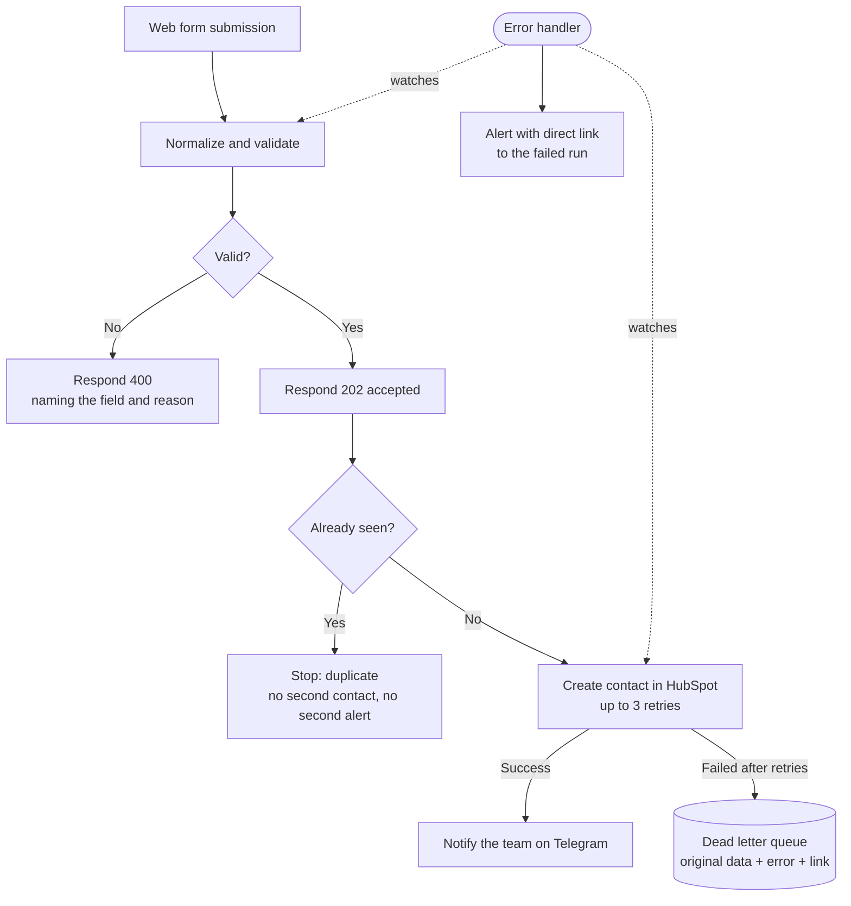

# Lead Intake Automation — Handover

**Delivered:** 23 October 2026
**Platform:** n8n 2.44.6 (self-hosted)
**Systems connected:** Web form → HubSpot CRM → Telegram

---

## 1. What this does

Every lead submitted through your web form is validated, cleaned, checked
against what you already have, written to HubSpot, and announced to your team.

Anything that can't be written is **kept in a queue with the original
submission**, so no lead is ever silently lost.

### Why that last sentence matters

The workflow this replaces lost leads without any visible symptom. We measured
it: out of eight realistic submissions, **six returned a generic error and the
data was gone**. Nothing was stored, nothing was logged, nothing raised an
alert. The visitor saw "something went wrong" and left.

The most common cause was not exotic. It was an email address with a space in
front of it, because someone copied and pasted it.

With this workflow, all eight are accounted for: six are written, two are
rejected with a clear reason given back to the form, and anything that fails
downstream is preserved for review.

---

## 2. Workflow Design & Integration Mapping

### Nodes, in order

| # | Node | What it does |
|---|---|---|
| 1 | **Web form** | Receives the form submission over HTTPS |
| 2 | **Normalize and validate** | Trims whitespace, lowercases the email, converts the phone to international format, strips HTML, checks required fields and payload size |
| 3 | **Valid payload?** | Splits the flow: accepted or rejected |
| 4 | **Respond 202 accepted** | Answers the form immediately, before the CRM is contacted |
| 5 | **Respond 400 with detail** | Answers a rejected submission naming the field and the reason |
| 6 | **Drop duplicates** | Recognises a submission already seen, using the cleaned email |
| 7 | **Create contact in HubSpot** | Creates or updates the contact. Retries up to 3 times |
| 8 | **Notify the team** | Sends the new lead to your Telegram channel |
| 9 | **Save to dead letter queue** | Stores anything that failed all retries, with the original data |

A separate workflow, **Error handler**, watches all of the above and raises an
alert if something fails in a way none of these steps anticipated.

### Integrations and access required

| System | Access used | Scope granted |
|---|---|---|
| HubSpot | Service key (Bearer token) | `crm.objects.contacts.read`, `crm.objects.contacts.write` — nothing else |
| Telegram | Bot token | Send messages to one channel |
| n8n data table | Internal | Stores the dead letter queue |

The HubSpot key is scoped to contacts only. It cannot read or change deals,
companies, tickets, or any sensitive contact properties.

### Data handled

Name, email, phone, company and message, as submitted by the visitor. No
payment data, no credentials, no identity documents. Data is written to your
HubSpot account and to your own n8n instance. Nothing is sent anywhere else.

---

## 3. Process Flow Diagram



**The one thing to notice:** the form is answered at step `E`, *before* HubSpot
is contacted. If your CRM is slow or down, the visitor never sees an error and
never waits. That is also what prevents the duplicate that happens when someone
presses Submit twice.

---

## 4. Testing Notes & Validation Checklist

All scenarios below were executed against the live workflow, not simulated.

| # | Scenario tested | Result |
|---|---|---|
| 1 | Valid submission | ✅ `202` — contact created in HubSpot |
| 2 | Malformed email (`name@@domain`) | ✅ `400` — *email invalido: "diego.pereyra@@example"* |
| 3 | Email with leading/trailing spaces and capitals | ✅ `202` — cleaned and created |
| 4 | Required fields missing | ✅ `400` — *falta el campo requerido: email* |
| 5 | Identical submission sent twice | ✅ `202` — recognised as duplicate, not written again |
| 6 | Same lead, email typed differently | ✅ `202` — recognised as the same person |
| 7 | Submission containing HTML and SQL | ✅ `202` — blocked downstream, **preserved in the queue** |
| 8 | 1 MB payload | ✅ `400` — *payload demasiado grande: 1048791 bytes* |

**Zero server errors across all eight.** Every rejection states which field
caused it.

### Automated check

The validation logic has its own test, which can be run at any time without
starting n8n:

```bash
node test-normalizacion.js
```

Ten assertions. The test reads the logic directly out of the workflow file, so
it cannot drift out of date if the workflow is edited later.

### Known limitations

Stated plainly, so there are no surprises:

- **Phone numbers without an international prefix.** A foreign number entered
  without `+` is assumed to be local and gets the default country code. It will
  look valid and be wrong. The fix belongs in the form — a separate country
  field, or a placeholder asking for international format — not in the
  workflow.
- **Duplicate detection uses the email address only.** Two different people
  sharing one company inbox will be merged into a single contact. If that
  matters for your business, the matching rule can be changed.
- **Scenario 7 still fails.** A submission containing script or SQL text is
  blocked by HubSpot's security layer. We deliberately do **not** strip that
  text, because filtering "suspicious" characters breaks legitimate names like
  O'Brien. The lead is preserved in the queue instead.
- **Duplicate history is stored with the workflow.** If the workflow is deleted
  and recreated, previously seen leads are forgotten. For long-term retention
  this can be moved to a table.

---

## 5. Handover Summary

### What you received

1. Three importable workflow files (`.json`)
2. This document
3. Eight test submissions used to validate the system
4. The automated validation test

### Setup, once

1. Import the three workflow files into n8n.
2. **Publish the error handler first.** n8n will not let you select an
   unpublished workflow as an error handler.
3. Create the `lead_dead_letter` data table (schema in the technical README).
4. Add the HubSpot credential: type **App Token**, using a HubSpot service key.
5. Add the Telegram credential and set the channel ID.
6. Publish both lead workflows.
7. Point your web form at the production webhook URL.

### Day-to-day maintenance

**There is nothing to do on a normal day.** The things worth watching:

| Signal | What it means | What to do |
|---|---|---|
| Telegram alert from the error handler | Something failed that wasn't anticipated | Open the link in the alert; it goes straight to the failed run |
| A new row in `lead_dead_letter` | A lead could not be written after 3 attempts | See the runbook below |
| No leads arriving at all | The workflow may be unpublished, or the form may be pointing elsewhere | Check that both workflows show as published |

### Runbook: a row appeared in the dead letter queue

1. Open the row. It contains the original submission, the error message, which
   step failed, and the run ID.
2. Read `error_message`. **Treat it with suspicion** — HubSpot's errors are not
   always accurate. In particular, *"Forbidden - perhaps check your
   credentials"* usually does **not** mean the credential is wrong: it means
   the security layer rejected the content of the submission.
3. If the lead is legitimate, create the contact manually from the `payload`
   column. Nothing is lost.
4. If rows start appearing in volume, something changed upstream — an expired
   credential, a HubSpot limit, or a form sending a new field. That is worth a
   look rather than manual entry.

### Credential expiry — the one thing that will bite

HubSpot service keys and n8n API keys **expire**. When they do, the workflow
stops writing and the dead letter queue starts filling up with authentication
errors.

Put a calendar reminder two weeks before each expiry date. This is the single
most common reason an automation that "worked for months" stops working.

---

## 6. Scope

### Included

- The three workflows as delivered, validated against the eight scenarios above
- This documentation
- Correction of any defect in what was delivered

### Not included — quotable separately

- Changes to the form itself
- Additional destination systems
- Changes to the matching rule used for duplicates
- Mapping to custom HubSpot properties beyond the fields listed
- Ongoing monitoring or operation of the queue
- Automatic reprocessing of queued leads (currently manual, by design: a
  failure usually needs a human decision before it is retried)

---

## Questions

Anything in this document that isn't clear is a defect in the document, not in
your understanding. Ask and it gets rewritten.
